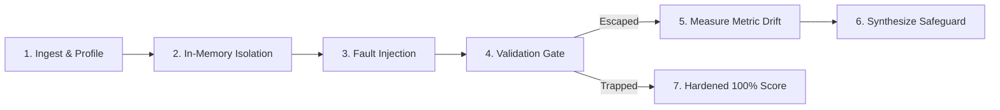
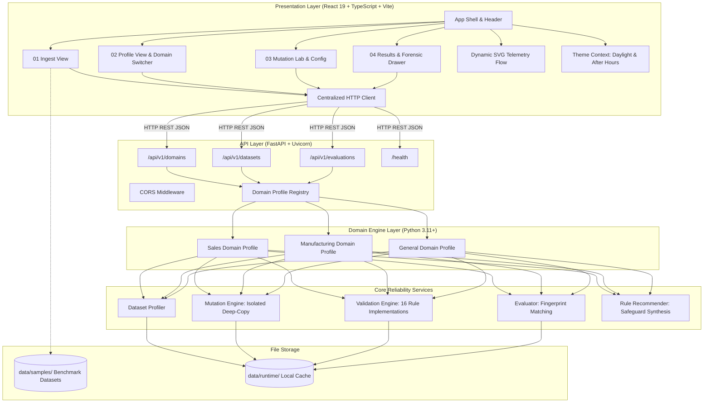

# DataTripwire

## Data Pipeline Reliability & Mutation Testing

> **"Break the data. Test the safeguards. Protect the metrics."**

[](https://www.python.org/downloads/)
[](https://nodejs.org/)
[]()
[]()
[](LICENSE)
[](docs/DataTripwire_Project_Report.pdf)

---

**DataTripwire** injects controlled faults into datasets to evaluate whether existing data-quality validation rules detect those faults.

**Core Differentiator:** Traditional data-quality tools passively monitor whether a dataset passes validation rules. DataTripwire operates as an **adversarial crash-testing laboratory for data pipelines**: it tests whether those rules can actually catch realistic data failures before corrupt data reaches downstream dashboards, predictive models, or financial reporting.

---

## Table of Contents

- [1. Project Overview](#1-project-overview)
- [2. Problem Statement](#2-problem-statement)
- [3. Proposed Solution](#3-proposed-solution)
- [4. How DataTripwire Works](#4-how-datatripwire-works)
- [5. Key Features](#5-key-features)
- [6. Actual Implementation Status](#6-actual-implementation-status)
- [7. Supported Dataset Types & Schemas](#7-supported-dataset-types--schemas)
- [8. Supported Mutation Operators](#8-supported-mutation-operators)
- [9. Validation Rules](#9-validation-rules)
- [10. Business Metrics & Mutation Scoring](#10-business-metrics--mutation-scoring)
- [11. Architecture Diagram](#11-architecture-diagram)
- [12. Technology Stack](#12-technology-stack)
- [13. Repository Structure](#13-repository-structure)
- [14. Sample Datasets](#14-sample-datasets)
- [15. Installation Requirements](#15-installation-requirements)
- [16. One-Click Startup Instructions](#16-one-click-startup-instructions)
- [17. Manual Development Setup](#17-manual-development-setup)
- [18. API Documentation](#18-api-documentation)
- [19. Testing Instructions](#19-testing-instructions)
- [20. Main Demonstration Scenarios](#20-main-demonstration-scenarios)
- [21. Known Limitations](#21-known-limitations)
- [22. Future Roadmap](#22-future-roadmap)
- [23. Contribution Guidelines](#23-contribution-guidelines)
- [24. License Information](#24-license-information)
- [25. Project Report & Documentation](#25-project-report--documentation)

---

## 1. Project Overview

Data pipelines are the invisible foundation of modern analytics, machine learning, and operational decision-making. However, data engineering teams frequently suffer from a dangerous blind spot: **untested data validation rules**.

Teams write data quality assertions assuming their checks will catch upstream anomalies. In practice, subtle schema drift, duplicate events from webhook retries, dropped records during extract-load stages, and non-physical sensor readings slip through passive checks. Pipelines terminate with status code `0`, yet the resulting executive dashboards display inflated revenue, skewed averages, or corrupted equipment telemetry.

DataTripwire addresses this by applying **mutation testing**—a rigorous methodology borrowed from software defect analysis—directly to tabular datasets and data pipelines. By introducing deliberate, isolated mutations into clean baseline data, DataTripwire verifies whether your validation guards trap the faults or let them escape into business metrics.

---

## 2. Problem Statement

In production data stacks, pipeline failures rarely manifest as hard crashes. Instead, they present as **silent data degradation**:

1. **Transaction Duplication:** Upstream payment gateways retry failed webhooks, duplicating order rows. Without strict primary key constraints, aggregate sales figures inflate silently.
2. **Missing Attribute Drift:** Mandatory attributes arrive as `null` or whitespace. Downstream SQL aggregations quietly drop rows during inner joins or miscalculate averages.
3. **Domain Boundary Violations:** Software bugs produce negative unit prices or zero quantities, skewing Average Order Value (AOV) and unit economics.
4. **Dropped Records & Unreconciled Batches:** Incomplete ingestions silently drop partitions without triggering execution errors because control-total row count reconciliation is absent.
5. **Multi-Asset Telemetry Collisions:** In industrial IoT pipelines, multiple machines stream sensor frames at the same timestamp. Simple single-column uniqueness fails, permitting duplicate machine readings that corrupt energy accounting and predictive maintenance models.

**Traditional data validation tools verify the dataset against rules. DataTripwire tests whether the rules themselves are capable of protecting your metrics.**

---

## 3. Proposed Solution

DataTripwire introduces a closed-loop reliability harness:

- **Isolated In-Memory Mutation:** Original data files remain 100% immutable. The engine deep-copies tabular data into memory (`df.copy(deep=True)`) and applies targeted synthetic corruptions.
- **Dual-Domain Specialization:** Specialized evaluation engines for **E-Commerce Sales** (monetary revenue calculations) and **Manufacturing / Industrial IoT** (energy consumption, machine vibration, temperatures, yield pass rates).
- **Adversarial Evaluation:** Active validation rules execute against the mutated data. The system separates preexisting defects from newly injected mutations using deterministic row fingerprint matching.
- **Metric Drift Quantification:** The platform calculates the downstream business or physical impact of surviving mutations using exact numerical arithmetic (Python `Decimal` for financial metrics).
- **Automated Safeguard Synthesis:** When a mutation bypasses active checks (a surviving mutant), DataTripwire automatically synthesizes an executable validation rule recommendation to harden the pipeline.

---

## 4. How DataTripwire Works

DataTripwire executes a 6-stage adversarial evaluation lifecycle:



1. **Ingest & Profile:** Upload a custom CSV or load a bundled benchmark. The profiler analyzes data types, null distributions, unique constraints, and automatically resolves the domain profile (`sales`, `manufacturing`, or `general`).
2. **In-Memory Isolation:** Datasets are copied in-memory with zero disk contamination. Baseline metrics are captured prior to fault injection.
3. **Fault Injection:** The user or automated harness configures synthetic corruptions (`duplicate_row`, `invalid_quantity`, `duplicate_sensor_reading`, etc.) with deterministic random seeds.
4. **Validation Gate:** Configured validation safeguards execute against the corrupted dataset. The evaluator tracks whether each fault triggered an alert.
5. **Measure Downstream Drift:** If a fault escapes (survives), the metric engine computes the exact discrepancy between baseline metrics and mutated metrics.
6. **Synthesize Safeguards:** The recommendation engine generates targeted rule configurations and executable Python validation code to close the detected vulnerability.

---

## 5. Key Features

- **Multi-Domain Reliability Architecture:** Native support for both E-Commerce transactional records and Industrial IoT sensor telemetry, alongside generic tabular CSV profiling.
- **Isolated In-Memory Mutation Engine:** 10 deterministic mutation operators that simulate real-world data corruption without modifying baseline storage.
- **Configurable Validation Safeguards:** 16 validation rules covering primary keys, composite machine-timestamp uniqueness, physical sensor thresholds, non-negative monetary constraints, and row count reconciliation.
- **Deterministic Discrepancy Fingerprinting:** Separates preexisting baseline data anomalies from dynamically injected mutations to prevent false-positive scoring.
- **Exact Monetary & Scientific Metric Arithmetic:** Uses Python `Decimal` (`ROUND_HALF_UP`) for financial precision and floating-point aggregations for multi-machine sensor physics.
- **Automated Rule Recommendation Engine:** Automatically inspects escaping mutations and synthesizes ready-to-deploy rule configurations with executable code snippets.
- **Production React 19 Frontend Cockpit:** Modern, responsive 4-stage interface featuring SVG pipeline flow animations, real-time metric delta banners, and forensic inspection drawers.
- **Dual-Theme Design System:** Engineered with *Daylight Lab* (light) and *After Hours* (dark) themes, complete with technical gridlines, high-contrast typography, and persistent user preference.
- **Windows One-Click Startup & Cross-Platform Orchestration:** Native Windows batch launcher (`start_datatripwire.bat`) and cross-platform supervisor (`scripts/dev.py`) with port polling and PID-tree termination.
- **100% Local Privacy:** Operates entirely on the local machine with zero external cloud dependencies or telemetry tracking.

---

## 6. Actual Implementation Status

DataTripwire's codebase has been audited and classified according to actual verification:

| Capability / Module | Status | Verification Details |
| :--- | :---: | :--- |
| **E-Commerce Sales Domain (`sales`)** | **A. Implemented & Verified** | Full schema validation, 5 mutation operators, 7 validation rules, exact Decimal revenue metrics, tested across 115 tests. |
| **Manufacturing IoT Domain (`manufacturing`)** | **A. Implemented & Verified** | 18-column telemetry schema, 5 mutation operators, 9 validation rules (incl. composite machine/timestamp uniqueness), 12 metrics, verified on 5,040 rows across 25 unit/integration tests. |
| **General Tabular Profiling (`general`)** | **A. Implemented & Verified** | Structural profiling, data type inference, null counts, and summary statistics for arbitrary CSV uploads. |
| **Adversarial Evaluator & Scoring** | **A. Implemented & Verified** | Deterministic fingerprint matching, mutation detection scoring, surviving fault identification, and metric drift calculation. |
| **Rule Recommendation Engine** | **A. Implemented & Verified** | Deterministic safeguard synthesis generating executable Python code for both Sales and Manufacturing domains. |
| **React 19 Frontend Cockpit** | **A. Implemented & Verified** | 4-stage stepper, domain switcher, real-time SVG visualizer, forensic investigation drawer, verified via browser automation. |
| **Dual-Theme Design System** | **A. Implemented & Verified** | Daylight Lab & After Hours dark mode with CSS variables, zero FOUC, and localStorage persistence. |
| **One-Click Startup & Dev Supervisor** | **A. Implemented & Verified** | `start_datatripwire.bat` and `scripts/dev.py` with health polling, browser launch, and clean process tree termination. |
| **Synthetic Sample Benchmark Catalog** | **A. Implemented & Verified** | Published clean datasets in `data/samples/` (2,500 sales rows, 5,040 sensor rows, 60-row realistic sales test). |
| **16-Page Technical PDF Report** | **A. Implemented & Verified** | Generated via ReportLab at `docs/DataTripwire_Project_Report.pdf`, verified with exact 16-page budget. |
| **Automated Test Harness** | **A. Implemented & Verified** | 140 / 140 pytest backend tests passing (5.69s), 0 oxlint warnings/errors, clean Vite build. |
| **Warehouse & Database Connectors** | **D. Planned** | Direct database extraction (Snowflake, BigQuery, PostgreSQL) and Parquet/Delta Lake format drivers. |
| **Headless CI/CD CLI Runner** | **D. Planned** | Standalone CLI binary (`datatripwire run --ci`) for GitHub Actions and GitLab CI workflows. |
| **Distributed Multi-Gigabyte Engine** | **D. Planned** | DuckDB and Apache Arrow integration for multi-gigabyte and distributed dataset mutation testing. |

*Status Legend:*
- **A. Implemented & Verified:** Fully functional, integrated across frontend and backend, verified by automated test suites.
- **B. Implemented but Not Fully Verified:** Feature exists in code but lacks exhaustive end-to-end integration tests.
- **C. Partially Implemented:** Underlying interfaces exist, but key components or UI integrations remain in progress.
- **D. Planned:** Documented on roadmap for future development cycles.

---

## 7. Supported Dataset Types & Schemas

DataTripwire supports three operational domain profiles:

### 1. E-Commerce Sales Profile (`sales`)
- **Required Columns:** `transaction_id`, `customer_id`, `quantity`, `unit_price`, `transaction_date`
- **Optional Columns:** `product_id`, `product_category`, `payment_method`, `city`, `sales_channel`
- **Data Types:** String IDs, integer quantities, floating-point prices, ISO-8601 `YYYY-MM-DD` dates.
- **Target Analysis:** Financial metric protection, transaction deduplication, order volume integrity.

### 2. Manufacturing & Industrial IoT Profile (`manufacturing`)
- **Required Columns:** `reading_id`, `timestamp`, `machine_id`, `temperature_c`, `pressure_bar`, `vibration_mm_s`, `motor_current_a`, `power_kw`, `energy_kwh_20min`, `units_produced`, `defect_count`, `quality_pass_rate_pct`, `machine_status`
- **Optional Columns:** `facility_id`, `production_line`, `product_family`, `batch_id`, `shift`
- **Data Types:** String asset identifiers, ISO-8601 telemetry timestamps, floating-point physical measurements, integer unit counts.
- **Target Analysis:** Equipment monitoring reliability, multi-machine timestamp collisions, energy consumption drift, production yield consistency.

### 3. General Tabular Profile (`general`)
- **Required Columns:** Any valid CSV with a header row.
- **Capabilities:** Column statistics, missing value analysis, data type inference, structural profiling. Mutation testing and domain-specific metric drift are disabled for generic schemas.

---

## 8. Supported Mutation Operators

DataTripwire provides 10 deterministic mutation operators across its active domains:

### E-Commerce Sales Domain Mutations
| Mutation Operator | Injection Target | Description & Testing Purpose |
| :--- | :--- | :--- |
| `duplicate_row` | Primary Key (`transaction_id`) | Clones an existing transaction row, simulating webhook retry storms and transaction replay. |
| `missing_required_value` | Mandatory Columns | Replaces valid values with `np.nan`, testing pipeline resilience against upstream missing fields. |
| `invalid_quantity` | Numerical Column (`quantity`) | Mutates quantities to `0` or negative integers, verifying lower boundary constraints. |
| `invalid_unit_price` | Currency Column (`unit_price`) | Mutates prices to negative numbers (e.g., `-100.00`), testing monetary non-negativity safeguards. |
| `dropped_row` | Row Count | Removes rows from the dataset, verifying record count and batch control reconciliation. |

### Manufacturing & Industrial IoT Mutations
| Mutation Operator | Injection Target | Description & Testing Purpose |
| :--- | :--- | :--- |
| `duplicate_sensor_reading` | Asset & Timestamp | Clones a sensor frame for a specific `machine_id` and `timestamp`, testing composite uniqueness. |
| `missing_sensor_value` | Telemetry Channels | Injects `null` into critical sensor fields (`temperature_c`, `pressure_bar`, `vibration_mm_s`). |
| `invalid_sensor_value` | Physical Sensor Bounds | Injects extreme non-physical values (e.g., `-50.0°C` or `500.0°C`), testing operating range filters. |
| `dropped_sensor_reading` | Telemetry Stream | Removes telemetry frames, testing expected 20-minute interval frame reconciliation. |
| `invalid_production_value` | Production Counts | Violates production logic by setting `defect_count > units_produced` or invalid pass rates. |

---

## 9. Validation Rules

DataTripwire features 16 configurable validation rules:

### E-Commerce Sales Validation Rules
1. `REQUIRED_VALUE_MISSING`: Asserts mandatory columns contain non-null, non-whitespace values.
2. `QUANTITY_NOT_POSITIVE`: Asserts that transaction quantities are strictly positive (`quantity >= 1`).
3. `UNIT_PRICE_NEGATIVE`: Asserts that unit prices are non-negative (`unit_price >= 0.00`).
4. `TRANSACTION_ID_DUPLICATE`: Asserts unique primary keys across all records in the batch.
5. `EXPECTED_ROW_COUNT_MISMATCH`: Reconciles ingested row counts against expected control totals.
6. `DATE_FORMAT_INVALID`: Asserts strict ISO-8601 `YYYY-MM-DD` date formatting.
7. `UNEXPECTED_FIELD_VALUE`: Asserts categorical values match allowed whitelist sets.

### Manufacturing & Industrial IoT Validation Rules
1. `SENSOR_READING_ID_DUPLICATE`: Asserts primary key uniqueness on `reading_id`.
2. `MACHINE_TIMESTAMP_DUPLICATE`: Asserts composite uniqueness on `(machine_id, timestamp)`. *Critical safeguard preventing multi-machine stream collisions.*
3. `SENSOR_VALUE_MISSING`: Asserts all active telemetry channels contain non-null readings.
4. `SENSOR_VALUE_NON_NUMERIC`: Asserts telemetry readings are valid finite numeric floats.
5. `SENSOR_VALUE_NEGATIVE`: Asserts physical measurements (pressure, vibration, current, power) are non-negative.
6. `QUALITY_PASS_RATE_INVALID`: Asserts quality pass rates remain strictly within the `[0.0, 100.0]` range.
7. `PRODUCTION_DEFECT_EXCEEDS_UNITS`: Asserts production consistency: `defect_count <= units_produced`.
8. `TEMPERATURE_OUT_OF_BOUNDS`: Asserts operating temperatures stay within configured operational thresholds (`[40.0°C, 95.0°C]`).
9. `EXPECTED_RECORD_COUNT_MISMATCH`: Reconciles telemetry record counts against expected shift batch totals.

---

## 10. Business Metrics & Mutation Scoring

### Business & Operational Metrics
DataTripwire computes exact baseline and post-mutation metrics to measure downstream damage:

- **E-Commerce Sales:**
  - Total Revenue: $\sum (\text{quantity} \times \text{unit\_price})$, calculated using Python `Decimal('0.01')` with `ROUND_HALF_UP`.
  - Total Transactions: Total record count.
  - Unique Customers: Distinct count of customer accounts.
  - Average Order Value (AOV): Total Revenue divided by Total Transactions.
  - Financial Metric Drift: Exact net inflation or deflation ($\Delta \text{Revenue}$).

- **Manufacturing & Industrial IoT:**
  - Total Sensor Readings & Monitored Machine Count.
  - Cumulative Energy Consumption (kWh): $\sum \text{energy\_kwh\_20min}$.
  - Total Units Produced & Total Defect Count.
  - Operational Yield: Overall Quality Pass Rate ($\%$).
  - Physical Telemetry Means: Average & Peak Temperature (°C), Vibration (mm/s), Pressure (bar), Motor Current (A).

### Mutation Score Formulation
The mutation score measures the effectiveness of configured validation rules:

$$\text{Mutation Score} = \left( \frac{\text{Detected Mutations}}{\text{Total Eligible Mutations}} \right) \times 100$$

- **Detected Mutations:** Injected faults that triggered at least one validation rule alert.
- **Surviving Mutations:** Injected faults that slipped past all active validation checks undetected.
- **Zero-Denominator Safety:** If zero mutations are evaluated, the score safely returns `None` (`N/A`), avoiding division-by-zero errors.

---

## 11. Architecture Diagram



---

## 12. Technology Stack

- **Backend:** Python 3.11+ (verified on Python 3.14.3), FastAPI, Uvicorn, Pandas, Pydantic v2, Python `Decimal`.
- **Frontend:** React 19, TypeScript, Vite, Tailwind-free custom CSS design system, Lucide React icons.
- **Testing & Quality Assurance:** pytest, anyio, HTTPX/TestClient, oxlint, ReportLab (PDF documentation engine).
- **Process Orchestration:** Native Windows Command batch (`start_datatripwire.bat`) and cross-platform Python supervisor (`scripts/dev.py`).

---

## 13. Repository Structure

```text
DataTripwire/
├── start_datatripwire.bat          # Native Windows one-click launcher
├── scripts/
│   ├── dev.py                      # Process supervisor with port polling & clean shutdown
│   ├── check_setup.py              # Environment diagnostic verification utility
│   ├── run_tests.py                # Unified test runner (pytest + oxlint + vite build)
│   └── generate_pdf_report.py      # ReportLab engine generating 16-page PDF specification
├── docs/
│   ├── DataTripwire_Project_Report.pdf   # Official 16-page technical report
│   └── DataTripwire_Project_Report.md    # Markdown mirror of project report
├── data/
│   └── samples/                    # Published clean synthetic benchmark datasets
│       ├── README.md               # Dataset inventory, schemas, and usage guide
│       ├── ecommerce_showcase_2500.csv
│       ├── manufacturing_iot_sensor_readings_5040.csv
│       └── realistic_sales_test.csv
├── backend/
│   ├── pyproject.toml              # Backend dependencies and configuration
│   ├── src/datatripwire/
│   │   ├── api/                    # FastAPI routes, schemas, and middleware
│   │   ├── domains/                # Modular domain profiles (sales, manufacturing, general)
│   │   ├── domain/                 # Pydantic v2 models and contracts
│   │   ├── services/               # Profiler, mutation engine, validators, metrics, evaluator
│   │   ├── repositories/           # Runtime file persistence
│   │   └── data/                   # Bundled demo fixtures (sample_sales, sample_manufacturing)
│   └── tests/                      # 140 unit and integration tests
├── frontend/
│   ├── package.json                # Frontend dependencies and scripts
│   ├── index.html                  # HTML entry point with FOUC prevention
│   └── src/
│       ├── components/             # Views (Upload, Profile, Configure, Results) & SVG flow
│       ├── context/                # Theme context (Daylight & After Hours)
│       ├── api/                    # Centralized typed HTTP API client
│       └── index.css               # Complete tokenized CSS design system
├── .env.example                    # Environment configuration template
├── .gitignore                      # Git exclusion rules (no secrets, no node_modules, no caches)
├── LICENSE                         # MIT License
└── README.md                       # Main repository documentation
```

---

## 14. Sample Datasets

The repository includes curated synthetic benchmark datasets organized in [`data/samples/`](data/samples/):

| Dataset File | Domain | Records | Columns | Primary Key | Key Testing Purpose |
| :--- | :---: | :---: | :---: | :--- | :--- |
| **[`ecommerce_showcase_2500.csv`](data/samples/ecommerce_showcase_2500.csv)** | `sales` | **2,500** | **10** | `transaction_id` | High-scale sales mutation testing & revenue drift. |
| **[`manufacturing_iot_sensor_readings_5040.csv`](data/samples/manufacturing_iot_sensor_readings_5040.csv)** | `manufacturing` | **5,040** | **18** | `reading_id` | Multi-machine telemetry frames & composite uniqueness. |
| **[`realistic_sales_test.csv`](data/samples/realistic_sales_test.csv)** | `sales` | **60** | **5** | `transaction_id` | Compact deterministic fixture for rapid test execution. |

*For complete schema specifications, column types, and field descriptions, refer to the [Sample Datasets Documentation](data/samples/README.md).*

---

## 15. Installation Requirements

### System Prerequisites
- **Python:** Version 3.11 or newer (tested on Python 3.14.3).
- **Node.js:** Version 18 or newer (v20+ recommended).
- **Git:** Installed and available in PATH.
- **Operating System:** Windows 10/11, macOS, or Linux.

---

## 16. One-Click Startup Instructions

On Windows 10/11, DataTripwire starts with a single double-click:

```cmd
Double-click: start_datatripwire.bat
```

### What `start_datatripwire.bat` Does:
1. Dynamically resolves the repository root directory.
2. Verifies Python 3.11+ and Node.js 18+ in your system PATH.
3. Automatically installs missing dependencies for both backend and frontend.
4. Spawns the FastAPI backend (`http://127.0.0.1:8000`) and Vite frontend (`http://127.0.0.1:5173`).
5. Polls health endpoints until services are confirmed live.
6. Automatically opens your default web browser to the application cockpit.
7. **Clean Shutdown:** Pressing **Ctrl+C** cleanly terminates all child processes using Windows PID-tree termination (`taskkill /F /T`), preventing orphaned background servers.

---

## 17. Manual Development Setup

For cross-platform development or multi-terminal workflows:

### Cross-Platform Supervisor
```bash
python scripts/dev.py
```

### Manual Individual Terminals

**Terminal 1: Backend**
```bash
cd backend
python -m pip install -e ".[dev]"
python -m uvicorn datatripwire.api.main:app --host 127.0.0.1 --port 8000 --reload
```

**Terminal 2: Frontend**
```bash
cd frontend
npm install
npm run dev -- --host 127.0.0.1 --port 5173
```

---

## 18. API Documentation

Interactive API documentation is automatically served by FastAPI:
- **Swagger UI:** `http://127.0.0.1:8000/docs`
- **ReDoc:** `http://127.0.0.1:8000/redoc`
- **Health Check:** `http://127.0.0.1:8000/health`

### Key Endpoints
| HTTP Method | Route | Description |
| :--- | :--- | :--- |
| `GET` | `/health` | System health check and version verification. |
| `GET` | `/api/v1/domains` | Lists all supported domain profiles, rules, and metrics. |
| `GET` | `/api/v1/domains/{domain_id}` | Retrieves specification for a specific domain profile. |
| `POST` | `/api/v1/datasets/sample` | Ingests and profiles the bundled sample dataset. |
| `POST` | `/api/v1/datasets` | Uploads a custom CSV dataset (with optional domain override). |
| `GET` | `/api/v1/datasets` | Lists all uploaded and profiled datasets. |
| `GET` | `/api/v1/datasets/{id}` | Retrieves metadata and structural profile for a dataset. |
| `POST` | `/api/v1/datasets/{id}/evaluations` | Executes a mutation evaluation and computes metric impact. |
| `GET` | `/api/v1/evaluations/{id}` | Retrieves an evaluation report by ID. |

---

## 19. Testing Instructions

DataTripwire includes a unified verification script:

```bash
python scripts/run_tests.py
```

### Actual Verified Test Results
```text
===========================================================
  DATATRIPWIRE // FULL TEST & BUILD VERIFICATION SUITE
===========================================================

[STAGE] Backend Tests (pytest)
-> 140 passed, 3 warnings in 5.69s (100% pass)

[STAGE] Frontend Lint (oxlint)
-> Found 0 warnings and 0 errors across 15 files in 20ms

[STAGE] Frontend Build & Typecheck (tsc + vite build)
-> built in 104ms (0 errors)

===========================================================
  SUMMARY OF TEST & BUILD RESULTS
===========================================================
  [PASSED] Backend Tests (pytest) (6.19s)
  [PASSED] Frontend Lint (oxlint) (0.32s)
  [PASSED] Frontend Build & Typecheck (tsc + vite build) (1.77s)
-----------------------------------------------------------
✓ ALL TEST AND BUILD STAGES PASSED SUCCESSFULLY.
```

### Running Individual Test Suites
```bash
# Run all backend unit and integration tests
cd backend && python -m pytest tests/ -v

# Run manufacturing domain tests specifically
cd backend && python -m pytest tests/unit/test_manufacturing.py tests/integration/test_manufacturing_workflow.py -v

# Run frontend linter
cd frontend && npx oxlint

# Run frontend production build
cd frontend && npm run build
```

---

## 20. Main Demonstration Scenarios

### Scenario A: E-Commerce Sales Revenue Trap
1. **Clean Baseline:** Ingest `sample_sales.csv` (15 transactions, ₹19,000.00 baseline revenue).
2. **Vulnerability Injection:** In **03 Mutation Lab**, select `duplicate_row` on order `ORD-101` (Customer: `CUST-001`, Quantity: `1`, Unit Price: `₹1,000.00`). Disable the `TRANSACTION_ID_DUPLICATE` validation rule. Click **Execute Evaluation**.
3. **Escaped Fault Observation:**
   - Mutation Score: **0% (Fault Survived)**.
   - Downstream revenue inflates to **₹20,000.00** (+₹1,000.00 net drift / +5.26% error).
   - The recommendation engine synthesizes a targeted safeguard: `UNIQUENESS on transaction_id`.
4. **Hardened Verification:** Click **⚡ Test Recommended Safeguard**. Re-execute the evaluation.
   - Mutation Score: **100% (Fault Trapped ✓)**.
   - Finding `TRANSACTION_ID_DUPLICATE` triggers specifically on `ORD-101`.
   - Reported revenue remains protected at **₹19,000.00** (exact **₹0.00 drift**).

### Scenario B: Manufacturing IoT Telemetry Collision
1. **Clean Baseline:** Ingest `data/samples/manufacturing_iot_sensor_readings_5040.csv` or click **Load Sample Dataset** when in manufacturing mode. The profiler confirms 5,040 clean readings across multiple machines.
2. **Vulnerability Injection:** Select `duplicate_sensor_reading` for machine `MCH-01` at timestamp `2026-10-08T00:00:00`. Disable the `MACHINE_TIMESTAMP_DUPLICATE` safeguard. Click **Execute Evaluation**.
3. **Escaped Telemetry Collision:**
   - Mutation Score: **0% (Fault Survived)**.
   - Cumulative energy consumption inflates by **+2.37 kWh**, and the duplicate sensor frame distorts machine vibration metrics.
4. **Hardened Verification:** Enable the `MACHINE_TIMESTAMP_DUPLICATE` safeguard. Re-execute the evaluation.
   - Mutation Score: **100% (Fault Trapped ✓)**.
   - Finding `MACHINE_TIMESTAMP_DUPLICATE` fires, protecting operational metrics.

---

## 21. Known Limitations

- **Tabular CSV Scope:** The current implementation processes CSV datasets. Connectors for Parquet, Avro, and Delta Lake are planned for future releases.
- **In-Memory Processing:** Datasets are processed in-memory using Pandas. Very large files exceeding system RAM require future integration with DuckDB or Apache Arrow.
- **Synchronous Execution:** Evaluation runs execute synchronously within HTTP request lifecycles. Asynchronous Celery/Redis background worker queues are scheduled for large enterprise deployments.

---

## 22. Future Roadmap

- **Phase 4: Multi-Format & CI/CD Integration**
  - Parquet and JSON columnar ingestion drivers.
  - Headless CLI runner (`datatripwire run --ci`) for GitHub Actions and GitLab CI pipelines.
  - Automated export of synthesized rules to Great Expectations and dbt test YAML contracts.
- **Phase 5: Cloud Data Warehouse Connectors**
  - Direct read connectors for Snowflake, Google BigQuery, and PostgreSQL.
  - Combinatorial multi-mutation fault injection.
- **Phase 6: Distributed Scale**
  - High-performance DuckDB / Apache Arrow execution engine for terabyte-scale pipelines.
  - Historical vulnerability drift tracking across releases.

---

## 23. Contribution Guidelines

Contributions are welcome! Please ensure all contributions:
1. Pass the complete test suite: `python scripts/run_tests.py`.
2. Adhere to repository conventions (Pydantic v2 schemas, type annotations, tokenized CSS design system).
3. Include unit tests covering new mutation operators, validation rules, or domain profiles.
4. Do not commit build artifacts, node_modules, cache directories, or credentials.

---

## 24. License Information

This project is licensed under the **MIT License**. See the [LICENSE](LICENSE) file for complete details.

---

## 25. Project Report & Documentation

For a comprehensive 16-page examination of DataTripwire's mathematical formulation, architectural diagrams, domain models, and forensic methodology, view the official project report:

📄 **[DataTripwire Comprehensive Project Report (16-Page PDF)](docs/DataTripwire_Project_Report.pdf)**  
📝 **[DataTripwire Project Report (Markdown Mirror)](docs/DataTripwire_Project_Report.md)**  
📊 **[Sample Datasets Catalog & Usage Guide](data/samples/README.md)**
