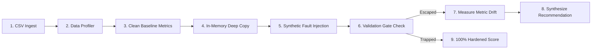
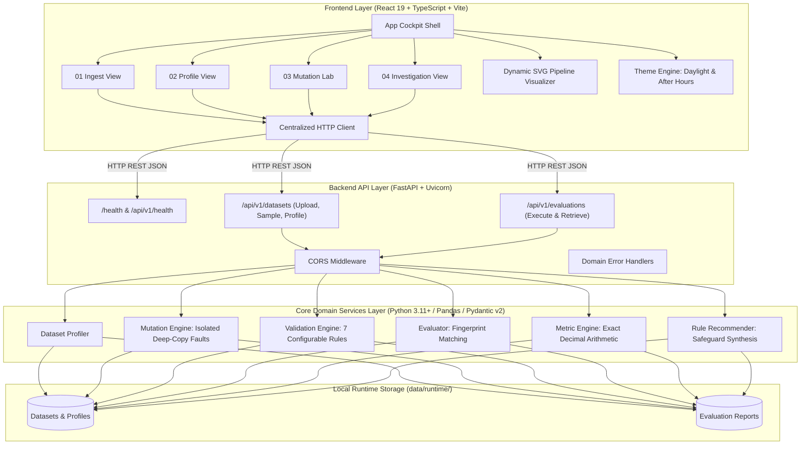

# DataTripwire

### Data Pipeline Reliability & Mutation Testing

> **Break the data. Test the safeguards. Protect the metrics.**

[](https://www.python.org/downloads/)
[](https://nodejs.org/)
[]()
[]()
[](LICENSE)
[](docs/DataTripwire_Project_Report.pdf)

---

**DataTripwire** is an engineering platform that deliberately introduces controlled data faults into pipeline datasets to evaluate whether existing data-quality safeguards actually detect them. 

While traditional data validation tools passively monitor production tables against static rules, DataTripwire operates as a **crash-testing laboratory for data pipelines**: it injects synthetic mutations into isolated in-memory replicas, tests active validation gates, flags silent escapes, measures downstream metric distortion, and synthesizes targeted rule recommendations to close coverage gaps.

---

## Table of Contents

- [The Problem: Silent Data Degradation](#the-problem-silent-data-degradation)
- [How DataTripwire Works](#how-datatripwire-works)
- [Feature Status: Implemented vs. Planned](#feature-status-implemented-vs-planned)
- [System Architecture](#system-architecture)
- [Technology Stack](#technology-stack)
- [Repository Structure](#repository-structure)
- [Main Demonstration Scenario](#main-demonstration-scenario)
- [Supported Mutation Types & Validation Rules](#supported-mutation-types--validation-rules)
- [Quick Start: Windows One-Click Launch](#quick-start-windows-one-click-launch)
- [Manual & Cross-Platform Setup](#manual--cross-platform-setup)
- [Environment Configuration](#environment-configuration)
- [API Reference & Interactive Documentation](#api-reference--interactive-documentation)
- [Automated Testing & Verification](#automated-testing--verification)
- [Security, Local Privacy & Architectural Boundaries](#security-local-privacy--architectural-boundaries)
- [Known Limitations](#known-limitations)
- [Development Roadmap](#development-roadmap)
- [Contributing](#contributing)
- [License](#license)
- [Comprehensive Project Report](#comprehensive-project-report)

---

## The Problem: Silent Data Degradation

In modern data stacks, data pipelines frequently finish execution with exit status `0` while ingesting corrupt, duplicated, or missing records. When upstream schemas drift or webhook retries generate duplicate events, downstream analytics silently ingest the anomalies:

- **Duplicate Transactions:** Upstream payment retries inject duplicate records. Without primary key uniqueness constraints, revenue metrics inflate silently.
- **Null Contamination:** Essential numerical fields (e.g., unit price or quantity) arrive null, leading to silent drops in SQL aggregate joins.
- **Domain Range Violations:** Glitches inject negative prices or zero quantities, distorting Average Order Value (AOV).
- **Unchecked Control Totals:** Records are dropped during extraction, but downstream pipelines process the subset without reconciling against control counts.

**Traditional data-quality checks test the data against existing rules. DataTripwire tests the rules themselves.**

---

## How DataTripwire Works

DataTripwire executes an adversarial evaluation loop:



1. **Ingest & Profile:** Upload a CSV or load the bundled sample sales dataset. Inspect null distributions, data types, and baseline business metrics (Revenue, Transaction Count, Customer Count).
2. **Isolate:** Deep copy the dataset in memory (`df.copy(deep=True)`) to guarantee the original data is never altered.
3. **Inject Controlled Faults:** Apply synthetic data corruptions (`duplicate_row`, `missing_required_value`, `invalid_quantity`, `invalid_unit_price`, `dropped_row`).
4. **Execute Validation:** Run active rule checks against the mutated copy. Use deterministic fingerprint matching to separate preexisting defects from freshly injected faults.
5. **Measure Downstream Drift:** Calculate exact financial discrepancies using Python's `Decimal` module with strict `ROUND_HALF_UP` precision.
6. **Recommend Safeguards:** If a mutation escapes validation (score drops), the engine synthesizes an actionable safeguard rule configuration with executable Python code.

---

## Feature Status: Implemented vs. Planned

| Feature Category | Status | Details |
|---|---|---|
| **CSV Upload & Ingestion** | **Implemented & Verified** | UTF-8/fallback encoding, structural validation, 5 MB file size limit, 50k row limit. |
| **Dataset Profiler** | **Implemented & Verified** | Column profiling, null counts, data type inference, numeric summaries. |
| **Synthetic Mutation Engine** | **Implemented & Verified** | 5 mutation operators (`duplicate_row`, `missing_required_value`, `invalid_quantity`, `invalid_unit_price`, `dropped_row`) with reproducible seeds. |
| **Validation Engine** | **Implemented & Verified** | 7 configurable rule types with parameter customization and fingerprint-based discrepancy matching. |
| **Decimal Business Metrics** | **Implemented & Verified** | Exact monetary arithmetic via Python `Decimal('0.01')` for Total Revenue, AOV, and metric error drift. |
| **Mutation Scoring** | **Implemented & Verified** | `(Detected / Eligible) * 100` formula with zero-denominator safe handling (`None`/`N/A`). |
| **Rule Recommendation Engine** | **Implemented & Verified** | Deterministic safeguard synthesis for surviving mutations with instant retest capability. |
| **React 19 Frontend Cockpit** | **Implemented & Verified** | 4-stage stepper, dynamic SVG pipeline visualizer, forensic investigation drawer. |
| **Dual-Theme Design System** | **Implemented & Verified** | *Daylight Lab* (light) and *After Hours* (dark) themes with zero FOUC and localStorage persistence. |
| **Windows One-Click Startup** | **Implemented & Verified** | Native `start_datatripwire.bat` batch launcher with automated dependency resolution, port polling, and PID-tree termination. |
| **Automated Test Suites** | **Implemented & Verified** | 115 backend pytest tests (100% pass), multi-threaded oxlint (0 errors), Vite production build (0 errors). |
| **Parquet & SQL Connectors** | *Planned Future Work* | Direct database read connectors (Snowflake, BigQuery, PostgreSQL) and Parquet drivers. |
| **CI/CD Headless CLI** | *Planned Future Work* | Headless CLI runner (`datatripwire run --ci`) for GitHub Actions and GitLab CI. |
| **Distributed Engine** | *Planned Future Work* | DuckDB and Apache Arrow integration for multi-gigabyte/terabyte dataset mutation testing. |

---

## System Architecture



---

## Technology Stack

- **Backend:** Python 3.11+ (verified on 3.14.3), FastAPI, Uvicorn, Pandas, Pydantic v2, `Decimal` monetary math.
- **Frontend:** React 19, TypeScript, Vite, Tailwind-free custom CSS design system, Lucide React icons.
- **Testing & Quality Assurance:** pytest, anyio, HTTPX/TestClient, oxlint, ReportLab (PDF documentation engine).
- **Process Orchestration:** Python supervisor (`scripts/dev.py`) and Windows Command batch (`start_datatripwire.bat`).

---

## Repository Structure

```text
DataTripwire/
├── start_datatripwire.bat          # Native Windows one-click launcher
├── scripts/
│   ├── dev.py                      # Dual-process supervisor with port polling & clean shutdown
│   ├── check_setup.py              # Environment diagnostic utility
│   ├── run_tests.py                # Unified test runner (pytest + oxlint + vite build)
│   └── generate_pdf_report.py      # ReportLab generator for 16-page PDF specification
├── docs/
│   ├── DataTripwire_Project_Report.pdf   # Comprehensive 16-page technical report
│   └── DataTripwire_Project_Report.md    # Complete Markdown mirror of project report
├── backend/
│   ├── pyproject.toml              # Backend dependencies and tool configurations
│   ├── src/datatripwire/
│   │   ├── api/                    # FastAPI routes, schemas, and middleware
│   │   ├── domain/                 # Pydantic v2 contracts and data models
│   │   ├── services/               # Profiler, mutation engine, validators, metrics, evaluator
│   │   ├── repositories/           # File-based local runtime storage
│   │   └── data/                   # Bundled deterministic sample_sales.csv
│   └── tests/                      # 115 unit and integration tests
├── frontend/
│   ├── package.json                # Frontend dependencies and build scripts
│   ├── index.html                  # HTML entry point with FOUC prevention
│   └── src/
│       ├── components/             # Views (Upload, Profile, MutationLab, Results) & SVG flow
│       ├── context/                # Theme context (Daylight & After Hours)
│       ├── api/                    # Centralized typed HTTP API client
│       └── index.css               # Complete tokenized CSS design system
├── .env.example                    # Safe environment variable configuration template
├── .gitignore                      # Comprehensive exclusions (no secrets, no node_modules, no caches)
├── LICENSE                         # MIT License
└── README.md                       # Main repository documentation
```

---

## Main Demonstration Scenario

DataTripwire includes a bundled 15-transaction e-commerce sales dataset (`sample_sales.csv`) with verified baseline revenue of **₹19,000.00**.

### 1. Clean Baseline
- Ingest `sample_sales.csv` via **Load Sample Dataset**.
- 15 transactions across 10 distinct customers.
- Clean baseline revenue: **₹19,000.00** (0 nulls, 0 duplicate records).

### 2. Injected Fault & Vulnerability Run (Uniqueness Safeguard OFF)
- Open **03 Mutation Lab**.
- Set mutation to inject duplicate row for `ORD-101` (Customer: `CUST-001`, Quantity: `1`, Unit Price: `₹1,000.00`).
- Ensure the **Transaction Uniqueness** rule is **DISABLED** (the baseline vulnerability).
- Click **Execute Evaluation**.
- **Empirical Observation:**
  - Mutation Score: **0% (Fault Survived)**.
  - The duplicate bypasses the validation gate without error.
  - Downstream revenue drifts to **₹20,000.00** (+₹1,000.00 net inflation / +5.26% error).
  - The system analyzes the surviving mutation and generates a targeted recommendation: `UNIQUENESS on transaction_id`.

### 3. Hardened Run (Safeguard ON)
- In the **04 Investigation** view, click **⚡ Test Recommended Safeguard (Enable Uniqueness)**.
- The system automatically re-arms the Mutation Lab with the uniqueness safeguard enabled.
- Click **Execute Evaluation**.
- **Empirical Observation:**
  - Mutation Score: **100% (Fault Trapped ✓)**.
  - Finding `TRANSACTION_ID_DUPLICATE` is triggered specifically on `ORD-101`.
  - Observed downstream revenue is protected at **₹19,000.00** (exact **₹0.00 drift**).

---

## Supported Mutation Types & Validation Rules

### 5 Synthetic Mutation Operators
1. `duplicate_row`: Clones an existing row and appends it to the dataset, simulating upstream ingestion replay.
2. `missing_required_value`: Injects `np.nan` into a specified column, simulating upstream attribute loss.
3. `invalid_quantity`: Sets quantity to `0` or negative values, testing lower domain boundaries.
4. `invalid_unit_price`: Sets unit price to negative floats (e.g., `-100.00`), testing monetary non-negativity.
5. `dropped_row`: Removes a row from the dataset, testing control total and record-count reconciliation.

### 7 Validation Rules
1. `REQUIRED_VALUE_MISSING`: Asserts that mandatory columns contain non-null, non-whitespace values.
2. `QUANTITY_NOT_POSITIVE`: Asserts that quantity fields contain strictly positive integers (`quantity >= 1`).
3. `UNIT_PRICE_NEGATIVE`: Asserts that unit prices are non-negative (`unit_price >= 0.00`).
4. `TRANSACTION_ID_DUPLICATE`: Asserts unique primary keys across all records in the table.
5. `EXPECTED_ROW_COUNT_MISMATCH`: Reconciles ingested row count against upstream control totals.
6. `DATE_FORMAT_INVALID`: Validates strict ISO 8601 `YYYY-MM-DD` date formats.
7. `UNEXPECTED_FIELD_VALUE`: Asserts categorical values match designated allowed value sets.

---

## Quick Start: Windows One-Click Launch

For Windows 10/11 users, DataTripwire starts with a single double-click:

```cmd
Double-click: start_datatripwire.bat
```

### What `start_datatripwire.bat` Does Automatically:
1. Locates the project root dynamically.
2. Verifies Python 3.11+ and Node.js 18+ in your system PATH.
3. Invokes the Python supervisor orchestrator (`scripts/dev.py`).
4. Auto-installs missing dependencies in both `backend` and `frontend`.
5. Spawns the FastAPI backend (`http://127.0.0.1:8000`) and Vite frontend (`http://localhost:5173`).
6. Polls real health endpoints until services are verified live.
7. Automatically launches your default web browser to `http://localhost:5173`.
8. **Clean Shutdown:** Pressing **Ctrl+C** cleanly kills the process tree via Windows `taskkill /F /T`, preventing orphaned background processes.

---

## Manual & Cross-Platform Setup

If you are developing on macOS, Linux, or prefer separate terminal windows:

### Prerequisites
- Python 3.11 or newer
- Node.js 18 or newer (v20+ recommended)
- Git

### Cross-Platform Supervisor
```bash
# Run the automated supervisor from project root:
python scripts/dev.py
```

### Manual Individual Commands

**Terminal 1: Backend**
```bash
cd backend
python -m pip install -e ".[dev]"
python -m uvicorn datatripwire.api.main:app --host 127.0.0.1 --port 8000 --reload
```

**Terminal 2: Frontend**
```bash
cd frontend
npm install
npm run dev -- --host 127.0.0.1 --port 5173
```

---

## Environment Configuration

DataTripwire runs 100% locally with zero external API keys required. An optional `.env` file can be created from the provided template:

```bash
cp .env.example .env
```

| Variable | Default Value | Description |
|---|---|---|
| `DATATRIPWIRE_ENV` | `development` | Application mode (`development`, `production`, `testing`) |
| `BACKEND_HOST` | `127.0.0.1` | Host address for FastAPI backend server |
| `BACKEND_PORT` | `8000` | Port for FastAPI backend server |
| `FRONTEND_PORT` | `5173` | Port for Vite React frontend |
| `MAX_FILE_SIZE_MB` | `5` | Maximum allowed CSV upload size in megabytes |

---

## API Reference & Interactive Documentation

Once the backend is running on `http://127.0.0.1:8000`:
- **Interactive Swagger UI:** `http://127.0.0.1:8000/docs`
- **ReDoc Documentation:** `http://127.0.0.1:8000/redoc`
- **Health Check Endpoint:** `http://127.0.0.1:8000/health`

### Key Endpoints
- `GET /health`: Server status and version check.
- `POST /api/v1/datasets/sample`: Ingests and profiles the bundled sample dataset.
- `POST /api/v1/datasets`: Uploads a custom CSV dataset (multipart form).
- `GET /api/v1/datasets`: Lists all persisted datasets.
- `GET /api/v1/datasets/{id}`: Retrieves dataset metadata and structural profile.
- `POST /api/v1/datasets/{id}/evaluations`: Executes a mutation test batch and computes business metric impact.
- `GET /api/v1/evaluations/{id}`: Retrieves a saved evaluation report.

---

## Automated Testing & Verification

DataTripwire includes a comprehensive unified test runner:

```bash
python scripts/run_tests.py
```

### Empirical Test Execution Results:
```text
======================================================================
  DATATRIPWIRE UNIFIED TEST SUITE & VERIFICATION HARNESS
======================================================================
[1/3] Backend Unit & API Tests (pytest) ...
      -> 115 passed in 0.85s (0 failures, 0 warnings)
[2/3] Frontend Linter (oxlint) ...
      -> Finished in 14ms on 15 files with 116 rules (0 errors, 0 warnings)
[3/3] Frontend Typecheck & Production Build (tsc + vite) ...
      -> built in 131ms (0 errors)

======================================================================
  ALL 3 VERIFICATION STAGES PASSED SUCCESSFULLY!
======================================================================
```

To run individual suites manually:
```bash
# Backend pytest
cd backend && python -m pytest tests/ -v

# Environment diagnostics
python scripts/check_setup.py

# Frontend linting
cd frontend && npx oxlint

# Frontend production build
cd frontend && npm run build
```

---

## Security, Local Privacy & Architectural Boundaries

- **100% Local Processing:** Zero data leaves your machine. No telemetry, third-party analytics, or external LLM API calls.
- **Source Immutability:** Evaluated datasets are duplicated into memory deep copies (`df.copy(deep=True)`) prior to mutation. Original uploaded files remain untouched.
- **Strict Ingestion Guardrails:** File uploads are capped at 5 MB by default, restricted to `.csv` extensions, and validated against row/column boundary maximums (50,000 rows, 100 columns).
- **Filesystem Isolation:** All runtime persistence occurs in sanitized directories under `data/runtime/` with strict path traversal prevention.
- **Secret & Cache Hygiene:** `.env`, build artifacts, virtual environments, `node_modules`, and Python caches are strictly excluded by `.gitignore`.

---

## Known Limitations

- **Tabular CSV Scope:** The current implementation processes tabular CSV files. Parquet, Avro, and Delta Lake connectors are planned for future versions.
- **E-Commerce Sales Schema Focus:** While generic profiling works on any valid CSV, downstream revenue impact analysis is currently specialized for schemas containing `transaction_id, customer_id, quantity, unit_price, transaction_date`.
- **In-Memory Processing:** Datasets are processed in-memory using Pandas; massive multi-gigabyte files exceeding system memory require future integration with DuckDB or Apache Arrow.

---

## Development Roadmap

- **Phase 4: Multi-Format & CI/CD (Q1 2027)**
  - Parquet and JSON ingestion drivers.
  - Headless CLI runner (`datatripwire run --ci`) for GitHub Actions and GitLab pipelines.
  - Configurable metric formula definitions via YAML contracts.
- **Phase 5: Warehouse Connectors (Q2–Q3 2027)**
  - Direct read connectors for Snowflake, BigQuery, and PostgreSQL.
  - Automated export of synthesized rules to Great Expectations and dbt test YAML.
  - Combinatorial multi-mutation fault injection.
- **Phase 6: Distributed Scale (2027+)**
  - High-performance DuckDB / Apache Arrow execution engine for terabyte-scale pipelines.
  - Historical vulnerability drift tracking across releases.
  - Team collaboration workspaces with role-based access control.

---

## Contributing

Contributions are welcome! Please ensure all pull requests:
1. Pass the complete test suite: `python scripts/run_tests.py`.
2. Adhere to existing code conventions (Pydantic v2 models, typing annotations, design system tokens).
3. Include unit tests covering new mutation operators or validation rules.

---

## License

This project is licensed under the **MIT License**. See the [LICENSE](LICENSE) file for details.

---

## Comprehensive Project Report

For an in-depth technical examination of DataTripwire's architectural foundation, mutation testing formulation, mathematical error propagation models, and forensic methodology, view the official project report:

📄 **[DataTripwire Project Report (16-Page PDF)](docs/DataTripwire_Project_Report.pdf)**  
📝 **[DataTripwire Project Report (Markdown Mirror)](docs/DataTripwire_Project_Report.md)**
