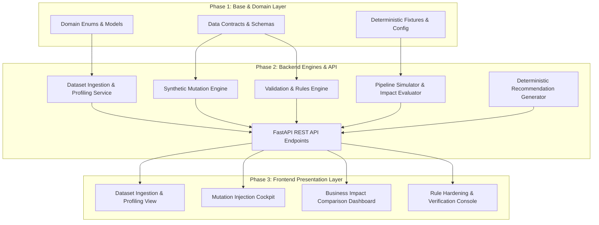
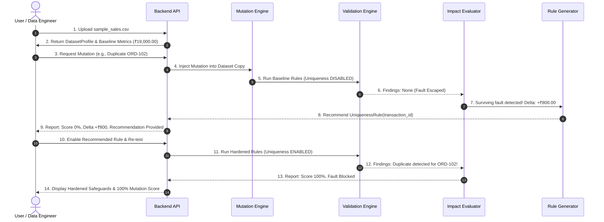

# DataTripwire: Technical Architecture

## 1. System Architecture Overview

DataTripwire is engineered with a clean, decoupled three-tier architecture that separates domain entities, backend processing engines, and the client presentation layer.

---

## 2. Layer Responsibilities

### Tier 1: Domain & Contracts Layer (Phase 1)
- **Zero Framework Coupling**: Pure Python 3.11+ and Pydantic v2 models. Independent of FastAPI, web servers, or databases.
- **Data Contracts**: Strict validation on data types, monetary decimal arithmetic, non-empty identifiers, and consistent mutation score metrics.
- **Deterministic Baseline Fixture**: Clean 15-row sales dataset (`sample_sales.csv`) with verified baseline revenue of ₹19,000.00 across 10 customers.

### Tier 2: Backend Services & REST API (Phase 2)
- **Ingestion & Profiler**: Ingests CSV uploads into pandas DataFrames and extracts metadata into `DatasetProfile`.
- **Mutation Engine**: Applies targeted synthetic faults (duplicate rows, missing values, invalid quantities, negative prices, dropped records) to **copies** of the baseline dataset. The clean source is never modified.
- **Validation Engine**: Executes a configurable collection of data-quality checks (`RuleType`). Uniqueness checking is intentionally configurable so baseline suites can omit it to demonstrate fault escape.
- **Pipeline Simulator & Impact Evaluator**: Executes downstream aggregations on clean vs. mutated data, computes metric deltas (e.g., revenue change), and evaluates whether validation findings caught the fault.
- **Recommendation Engine**: Deterministically maps surviving mutations to corresponding rule templates (e.g., escaping duplicate row -> `uniqueness` rule recommendation).
- **FastAPI Endpoints**: Lightweight HTTP layer serving serialized domain contracts to the frontend.

### Tier 3: Frontend Web Application (Phase 3)
- **React + TypeScript + Vite**: Fast, typed single-page application.
- **State Management**: Reactive state tracking uploaded datasets, active mutation experiments, and evaluation history.
- **Visual Presentation**: High-contrast, modern UI featuring side-by-side metric comparisons, delta warning banners, and one-click rule hardening workflows.

---

## 3. Data Flow Architecture

The lifecycle of an evaluation in DataTripwire progresses through six distinct stages:

---

## 4. Key Architectural Decisions

### 1. High-Precision Monetary Arithmetic
- Traditional binary floats (`0.1 + 0.2 != 0.3`) introduce rounding artifacts in financial aggregations.
- DataTripwire enforces `Decimal` with `ROUND_HALF_UP` to two decimal places across all revenue and order value computations.
- Pydantic models serialize Decimals as string representations in JSON payloads to prevent JavaScript floating-point truncation in the frontend.

### 2. Immutability of Source Datasets
- Synthetic mutations are applied exclusively to transient copies of tabular DataFrames.
- The pristine clean source fixture (`sample_sales.csv`) remains untouched, ensuring all test runs are fully reproducible.

### 3. Honest Evaluation Principle
- Mutation detection is **never hardcoded**.
- The evaluation engine does not mark a mutation as detected simply because it knows what mutation was injected.
- Instead, it inspects the actual `ValidationFinding` records produced by the validation engine on the mutated data. If no rule flagged the affected column or record, the mutation genuinely escapes.

### 4. Robust Mutation Scoring
The mutation score formula is strictly defined as:
$$\text{Mutation Score} = \frac{\text{Detected Eligible Mutations}}{\text{Successfully Applied Eligible Mutations}} \times 100$$
- If `successfully_applied == 0`, the score returns `None` (unavailable), preventing division by zero or misleading `0.0%` / `NaN` outputs.
- Failed mutation applications are excluded from both the numerator and denominator.
